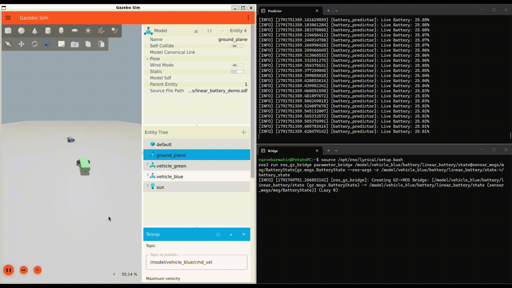

# 🔋 ROS 2 Battery-Aware Return-to-Base (RTB) Autonomous System

An intelligent, reactive power management and autonomous navigation handover system built for mobile robots using **ROS 2**, **Gazebo**, and **Nav2**. 

This project solves a critical edge case in autonomous robotics: monitoring real-time battery drain during manual or task execution, predicting critical depletion thresholds, and seamlessly overriding control to trigger an automated Return-to-Base (RTB) docking sequence.

---

## 🎥 Demonstration

> *A complete end-to-end run showing real-time battery telemetry drain, threshold prediction at 20%, and automated action server dispatch.*

**Youtube (https://youtu.be/Kg9H-koXbMk?si=aPhODEzcgTrejVWe)**

---

## 🚀 Key Features

* **Real-Time Battery Telemetry Bridge:** Utilizes `ros_gz_bridge` to link Gazebo's native physics linear battery sensor topics directly to standard ROS 2 `sensor_msgs/msg/BatteryState` messages.
* **Dynamic Threshold Prediction:** A custom Python node (`predictor_node`) that normalizes live charge states, handles dynamic discharge curves, and monitors safety buffers.
* **Autonomous Navigation Handover:** Automatically intercepts manual teleoperation control when a critical threshold (e.g., 20%) is breached, connecting to the Nav2 action server (`/navigate_to_pose`) to pilot the robot back to origin coordinates ($X=0.0, Y=0.0$).
* **Robust WSL/ROS 2 Error Handling:** Engineered with fault-tolerant network daemon management to withstand common middleware latency drops and rendering hiccups.

---

## 🛠️ System Architecture & Tech Stack

* **Middleware:** ROS 2 (Lyrical / Humble compatible)
* **Simulation Environment:** Gazebo Sim (Physics & Sensor Plugins)
* **Navigation Stack:** Nav2 (`navigation_launch.py`)
* **Language:** Python (`rclpy`)
